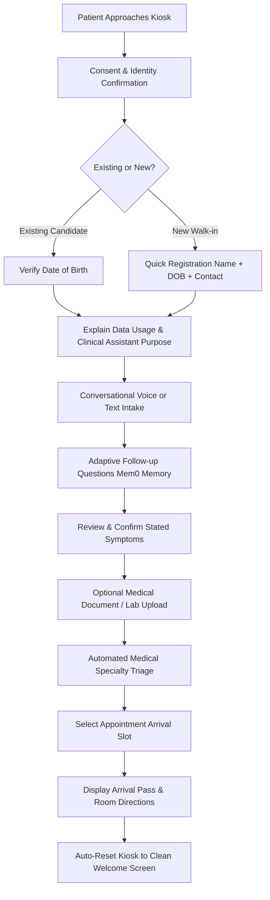

# ClinSync — Role-Based User Flows & Navigation Architecture

**Document Status:** PROPOSED & APPROVED FOR PHASE 1 IMPLEMENTATION  
**Owner:** Teammate A (Web/UX Designer) & Integration Captain  
**Reference Requirement:** TELEMEDICON 2026 Evaluation Directive (Phase 1 & Jury Feedback 1 & 2)  

---

## Executive Principle: Role Segregation & De-Cluttering

The single most critical UX failure identified by the jury is **dashboard conflation**:
> *"Differentiate the dashboards. Features and functions are cluttered in one dashboard. There is no clear distinction between user roles. Do not put the doctor's clinical workspace and the patient's kiosk inside one giant dashboard."*

In the target architecture, ClinSync completely dismantles the monolithic `LuxuryMasterDashboard`. The application will provide **three strictly separated, role-specific layouts with dedicated route guards and zero cross-role navigation leakage.**

```
                      +-----------------------------+
                      |     ClinSync Portal /       |
                      |     Landing & Entry Point   |
                      +--------------+--------------+
                                     |
           +-------------------------+-------------------------+
           |                         |                         |
           v                         v                         v
+---------------------+   +---------------------+   +---------------------+
|   PATIENT KIOSK     |   |   DOCTOR CONSOLE    |   |   HOSPITAL STAFF    |
|   Route: /kiosk     |   |   Route: /doctor    |   |   Route: /staff     |
+---------------------+   +---------------------+   +---------------------+
| - Walk-up tablet UI |   | - Requires MD Login |   | - Requires Staff    |
| - Full-screen mode  |   | - Queue by urgency  |   | - Walk-in intake    |
| - DOB confirmation  |   | - 60s Doctor Brief  |   | - Queue overview    |
| - Voice/text intake |   | - Clickable citations|  | - Room assignments  |
| - Document upload   |   | - Conflict ledger   |   | - Kiosk status reset|
| - Direct slot pick  |   | - Doctor sign-off   |   | - Operational audit |
| - NO DOCTOR TABS    |   | - NO KIOSK CONTROLS |   | - NO MEDICAL SIGN-OFF|
+---------------------+   +---------------------+   +---------------------+
```

---

## 1. Patient Kiosk Experience (`/kiosk` or `#/kiosk`)

### Target Persona & Constraints
- **User**: First-time patient or accompanied caregiver approaching a hospital intake tablet/kiosk.
- **Cognitive State**: Anxious, potentially in pain, unfamiliar with hospital department taxonomy.
- **Critical Invariant**: **Zero access to doctor queues, other patient records, or system configuration.** The top navigation bar, tabs, and administrative controls are completely removed from the kiosk view.

### Detailed Step-by-Step Patient Flow



#### Step 1: Identity Confirmation & Consent
- Screen displays clean hospital branding with language toggle (English, Hindi, etc.).
- Non-biometric by default: Patient types partial name or scans an arrival QR code.
- Candidate names are masked (`J*** D**`).
- Secondary factor: Patient confirms **Date of Birth** (`YYYY-MM-DD`).
- Fallback: "New Patient Registration" button opens a 3-field form (Full Name, Date of Birth, Phone).

#### Step 2: Clear Purpose Explanation
- Prominent calm banner:
  > *"ClinSync gathers your symptoms and medical records so your doctor has an organized summary before you walk into the consultation room. Your doctor will review everything with you."*

#### Step 3: Seamless Voice / Text Intake
- Large, accessible microphone button with live speech waveform.
- Voice Activity Detection (VAD) automatically finalizes input when patient pauses for 1.8 seconds.
- High-contrast text input fallback for noisy environments or hearing-impaired users.

#### Step 4: Contextual Follow-Up Questions
- Mem0 memory harness shapes follow-ups referencing prior complaints (e.g. *"You mentioned chest tightness started 4 days ago; does it spread to your left arm or jaw?"*).
- Hard ceiling: Maximum 4 follow-up questions before summarizing.

#### Step 5: Optional Document Upload
- Patient can attach previous discharge summaries, ECGs, or lab panels via camera or file picker.
- SHA-256 checksum recorded; immediate confirmation of page count.

#### Step 6: Automated Specialty Redirection & Slot Selection
- Patient is **not** asked to navigate medical specialties.
- An "Assigned Care Destination" card informs them:
  > *"Based on your chest discomfort, your consultation has been scheduled with the Cardiology & Chest Pain Clinic."*
- Patient simply selects their preferred arrival time (e.g. `10:30 AM`).

#### Step 7: Arrival Pass & Safe Kiosk Reset
- Displays digital arrival pass with room number and estimated wait time.
- Kiosk automatically wipes local memory and resets to the welcome screen after 30 seconds of inactivity or upon pressing "Done".

---

## 2. Doctor Dashboard (`/doctor` or `#/doctor`)

### Target Persona & Constraints
- **User**: Attending physician, consultant, or resident.
- **Work Environment**: Desktop monitor or clinical tablet in consultation room.
- **Primary Need**: Scan patient reason for visit, review objective evidence, and verify conflicting facts in **under 60 seconds**.

### Doctor Console Screen Layout

```
+-----------------------------------------------------------------------------------+
| Dr. Clara Chen (Cardiology) | Active Clinic Queue: 4 Patients Waiting | Sign Out  |
+---------------------+-------------------------------------------------------------+
| PATIENT QUEUE       | ACTIVE PATIENT CONSULTATION WORKSPACE                       |
|                     | Eleanor Johnson (58F) | Arrival: 10:15 AM | Triage: URGENT  |
| [!] Eleanor Johnson | +---------------------------------------------------------+ |
|     Chest Pain (4d) | | PRE-CONSULTATION CLINICAL BRIEF                         | |
|     Triage: URGENT  | | "Patient presents with a 4-day history of worsening dry | |
|                     | | cough and mild chest tightness [INTAKE-1]. Blood        | |
| [ ] David Kim       | | pressure measured 138/86 mmHg [DOC-1, p.1].             | |
|     Hypertension    | | Active prescription: Lisinopril 10mg daily [DOC-1, p.2]." |
|     Triage: ROUTINE | +---------------------------------------------------------+ |
|                     |                                                             |
| [ ] Sarah Lin       | +---------------------------+ +---------------------------+ |
|     Pediatric Cough | | CLINICAL CONTEXT LEDGER   | | PATIENT CONTEXT DIFF      | |
|     Triage: ROUTINE | | - Cough (Reported)        | | [!] Conflicting Fact:     | |
|                     | | - Lisinopril (Extracted)  | | Patient reports no allergy| |
|                     | | - Penicillin (Historical) | | EHR records Penicillin    | |
|                     | +---------------------------+ +---------------------------+ |
|                     |                                                             |
|                     | [ Play 45s Audio Brief ]   [ Inspect Original Documents ]   |
|                     |                                                             |
|                     | [ Add Clinical Notes / Reconcile ]   [ SIGN OFF ENCOUNTER ] |
+---------------------+-------------------------------------------------------------+
```

### Essential Doctor Journey Capabilities
1. **Prioritized Patient Queue**:
   - Encounters sorted automatically: `EMERGENCY` (Red) > `URGENT` (Amber) > `ROUTINE` (Emerald).
2. **Source-Linked Evidence Badges**:
   - Clicking `[DOC-1, p.2]` opens an overlay of the scanned document with the exact sentence highlighted.
3. **Explicit Conflict Highlighting**:
   - Inconsistencies between intake statements and historical records are flagged with a prominent alert icon.
4. **Physician Review & Sign-Off**:
   - The doctor can edit extracted facts or add personal consultation findings before committing the encounter to the medical record.

---

## 3. Hospital Staff Dashboard (`/staff` or `#/staff`)

### Target Persona & Constraints
- **User**: Front-desk receptionist, triage nurse, or clinic operations manager.
- **Work Environment**: Hospital front-desk desktop or mobile triage tablet.
- **Primary Need**: Assist walk-in patients, manage queue flow, monitor kiosk stations, and resolve scheduling bottlenecks.

### Hospital Staff Screen Layout

```
+-----------------------------------------------------------------------------------+
| ClinSync Hospital Operations | Front Desk Terminal 01 | Shift: Morning | Log Out  |
+---------------------+-------------------------------------------------------------+
| OPERATIONAL SUMMARY | QUEUE MANAGEMENT & PATIENT ASSISTANCE                       |
| Waiting: 7          |                                                             |
| In Consultation: 3  | [ + Register Walk-In Patient ]   [ Filter by Department v ] |
| Kiosks Active: 4/4  |                                                             |
|                     | Patient Name      Status        Department    Wait    Actions|
| KIOSK HEALTH        | Eleanor Johnson   Ready for MD  Cardiology    12m    [Call] |
| Kiosk 01: In Intake | David Kim         Checked In    Internal Med  4m     [Edit] |
| Kiosk 02: Idle      | Sarah Lin         In Consult    Pediatrics    --     [View] |
| Kiosk 03: In Intake | Marcus Vance      Intake Incom  Orthopedics   --     [Assist]|
| Kiosk 04: Idle      |                                                             |
|                     | +---------------------------------------------------------+ |
| QUICK ACTIONS       | | RECENT OPERATIONAL AUDIT LOG                            | |
| - Reset Kiosk 02    | | 10:14: Eleanor Johnson identity confirmed via DOB.      | |
| - Add Emergency Slot| | 10:02: Appointment Slot #402 booked for David Kim.      | |
| - Print Route Pass  | | 09:55: New walk-in registered: Sarah Lin.               | |
+---------------------+-------------------------------------------------------------+
```

### Essential Staff Capabilities
1. **Walk-In Registration Assistance**:
   - Fast registration modal for patients unable to use the automated kiosk.
2. **Queue Monitoring & Department Routing**:
   - Reassign consultation rooms or adjust scheduling when clinics run behind.
3. **Kiosk Fleet Status & Remote Reset**:
   - View whether kiosk units are in use, idle, or stalled on an incomplete turn; one-click reset for next patient.
4. **Audit Trail Review**:
   - Real-time log of check-ins, confirmations, and appointments without exposing confidential diagnostic notes.

---

## Summary of Route Separation & Security Controls

| Role | Allowed Route | Header Navigation | Permitted Backend Actions | Forbidden Views / Actions |
| :--- | :--- | :--- | :--- | :--- |
| **Patient** | `/kiosk` | None (Kiosk Fullscreen) | Candidate lookup, DOB confirm, intake answers, document upload, slot booking | Doctor queue, patient profiles, doctor sign-off, system metrics |
| **Doctor** | `/doctor` | Doctor Queue, Brief View, Audio, Documents | Queue read, brief review, citation inspection, encounter sign-off | Patient registration, kiosk reset, direct database edits |
| **Hospital Staff** | `/staff` | Registration, Queue Manager, Kiosk Status | Patient registration, queue monitoring, slot management, audit logs | Doctor clinical sign-off, confidential briefing narrative edits |
